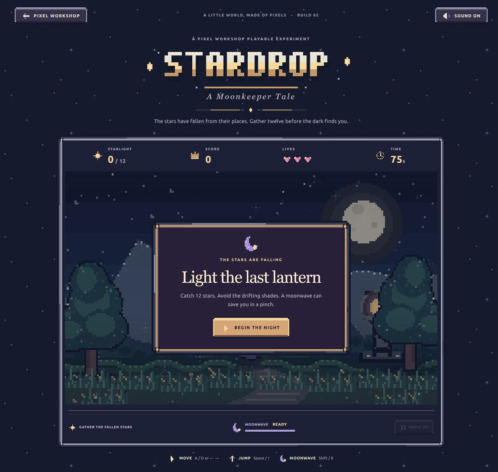
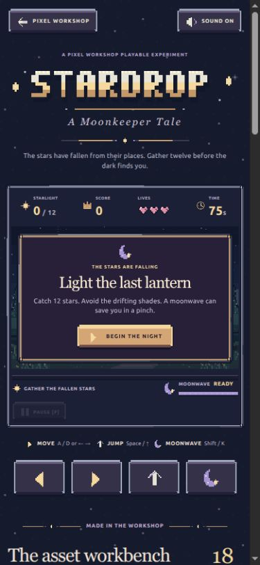

# Stardrop interface dogfood — 2026-11-04

**UI Kit v1 follow-up.** The observations below record the original dogfood, before the UI workbench was added. The editor now saves nine-slice and content insets, named button/icon frames, editable Tiny Caps text, and kit assignments in native projects; sprite atlases and game-pack manifests carry the UI metadata. Related projects can be recolored together, with Undo in each project. Stardrop can copy its UI projects into a workspace, preview edited copies in the same browser tab, and load an exported workshop game-pack ZIP without modifying the game source. The preview is local to that browser tab and can be restored to the original art.

Tiny Caps is one built-in Latin-oriented bitmap font; additional fonts, independent font-file export, and localization remain future work. Kit color replacement is an explicit batch of per-project edits rather than a live-linked palette, and a failed batch can be partially applied. Named UI states remain stored as frame references alongside animation data. These constraints are intentional boundaries of v1.

The follow-up hands-on review and prioritized remaining issues are in [UI Kit v1 workflow review](ui-kit-v1-workflow-review.md).

Anthony's brief: replace Stardrop's interface artwork using only assets made with Pixel Workshop, and record the gaps that become apparent. This is the game at `/play/moonkeeper`, rather than a redesign of the editor.

The eight new native projects are generated in `lib/stardrop-ui-art.ts` using the same `createDocument` and `applyCommands` engine as the existing game artwork. There are no external images, SVG icons, image-generation services, or CSS gradients drawing the UI skin. The page rasterizes those documents for its panels, button states, controls, title lettering, meters, night-sky tile and ornaments. Labels and changing numbers remain accessible live text. CSS provides layout, image slicing, focus outlines and state selection.

The complete gallery and downloadable game pack now contain eighteen projects. The button projects each contain rest, hover, pressed and disabled cels. The icon project contains sixteen individually named single-frame clips. These are static states, not a loop to play. UI preview cards show their whole family of states/icons rather than only the first cel. Artwork, source layers and state names survive the existing native export format.

**Stretchable panels need native slice guides.** The 48×48 panel has a 12 px protected edge on each side; the 48×24 buttons use 6 px edges. Stardrop has to provide CSS `border-image` and know these numbers externally. The editor cannot display draggable nine-slice guides or preview a border at several target sizes. The game pack's atlas has frame rectangles but no slice or content-inset fields. A reusable UI asset should carry both. This is the highest-value next patch.

**UI states are forced into animation clips.** Named frames let this work today, but a button is not an animation. Hover, pressed, disabled and focus are semantic states. Similarly, the sixteen icon cels share a document purely to avoid creating sixteen projects. A state-set/icon-set asset type with a clickable contact sheet and named exports would remove awkward timeline conventions. The page's family previews currently need their own canvas assembly code.

**There is no text or bitmap-font tool.** The Stardrop wordmark required a small hand-authored bitmap alphabet and many rectangle commands. A pixel-font text tool, editable text layer and bitmap-font export would make titles, labels and localized UI practical. Baking all gameplay numbers into images would harm readability and accessibility, so those labels deliberately remain live text in this demonstration.

**Shared palettes do not link assets.** The UI generator shares one palette constant, but each resulting project saves an independent copy. Recoloring the silver frame to match a revised icon, button and meter means editing multiple files or regenerating through code. A palette group with deliberate pack-wide remapping would make coherent skins much easier to iterate.

**The editor has no in-context component preview.** A border can look good at 48 px and break when stretched to 900 px or squeezed around a mobile menu. A preview showing sample buttons, panels, meters, and several target widths would expose that before integration. Export/import proves that the documents are editable; it does not by itself prove that a skin fits its content.

**Project-to-game iteration still requires glue.** Stardrop generates its source documents from repository code. Importing a downloaded document into a workspace lets a person edit it, but that workspace edit is not automatically used by the running game. A linked asset collection, stable exported identifiers and a deliberate publish-to-pack action would close this loop without tying a public game to a visitor's private workspace. The existing game pack is useful, but it is not yet an asset dependency system.

The scope here is to exercise these limitations and keep a complete usable result. The editor's generic format and export API are intentionally not expanded in this change; slice metadata, UI state assets and text authoring remain concrete follow-up work.

**Verification.** All 95 automated tests, TypeScript, the Node bundle and the Vercel production build pass. The eighteen-project ZIP builds and validates at 1,964,299 bytes. In the connected Chrome browser, the new production page was checked at its normal desktop size and at 390×844 and 320×740 viewport targets. At the smallest size the title menu fits inside the game stage and document scroll width matches client width. Start, sound toggle, keyboard moonwave, touch moonwave, pause and resume were exercised. The touch cooldown visibly changes to a countdown. Captured browser warnings came from an installed extension, not the game origin.

The browser's download-capture request timed out and reset its connection during the planned manual export/import round-trip. The connection was recovered and normal viewport restored. Native document validity, deterministic pixels, named states and pack contents are verified by the tests; a hands-on re-import of the downloaded UI project is not claimed as completed.

